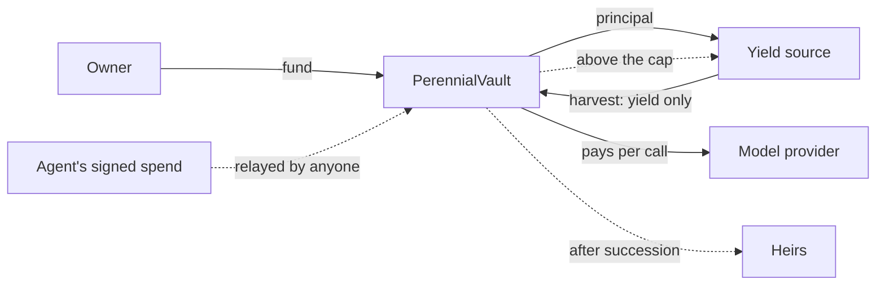

# Perennial

[](https://github.com/raldblox/perennial/actions/workflows/contracts.yml)
[](LICENSE)
[](https://build.qorechain.io/p/perennial)


**An inference budget your AI agent spends and nobody can steal.**

## Who it is for

Teams running AI agents that pay for their own inference. An agent needs
money to work, and the usual way to give it money is a funded wallet. A
wallet gives the whole balance to whoever holds its key: a leaked key, a
compromised agent, or, later, a quantum computer that recovers the classical
key from the chain.

## What it does

The owner, a person, funds a **position** for the agent. The agent pays for
each model call from it with `spend()`, signed by its own ML-DSA-87 key and
verified inside the contract. In budget mode no more than `payoutAmount`
leaves the position per `payoutInterval`, across spends and claims; a fuzz
test and an invariant check that bound
([decision 007](docs/decisions/007-budget-mode-and-income.md)). The owner can
close the position with one signature. If the agent goes silent, the budget
passes to its heirs.

For one 0.002 fUSD call an hour, a 500 fUSD position with a 1.46 fUSD monthly
budget lasts 28.5 years at 0% yield, which is what QoreChain pays a contract
today. Connected to a yield vault the budget refills itself and **lasts
indefinitely when the yield covers the spend**: at Aave v3 USDC's 4.29% (its
30-day mean on Ethereum, 16 November 2026) the same 500 fUSD earns 21.45 fUSD a
year against 17.52 spent. Anyone can also pay income into a position (`fund`),
so fees or revenue can keep an agent running.

## Why nobody can steal it

Every instruction needs a post-quantum signature checked in the contract
([decision 001](docs/decisions/001-pq-signed-actions.md),
[threat model](docs/threat-model.md)):

| Who has what | What they can take |
|---|---|
| A recovered or stolen **classical (secp256k1) key** of the agent or the owner, for example by a quantum computer | nothing: no spend, claim, check-in, heir change or close |
| The agent's stolen **ML-DSA-87 key** | at most one budget window (budget mode) or the buffer, until the owner closes |
| The owner's ML-DSA-87 key | the right to close, if it was kept at opening |

There is no admin, no custodian and no upgrade path. An agent's working key
can additionally be linked to its account with a chain-enforced spending rule,
a second limit independent of the vault's
([decision 009](docs/decisions/009-agent-keys-and-chain-spending-rules.md)).

## The three testnet vaults

Nothing on QoreChain pays a return a contract can collect today
([decision 006](docs/decisions/006-yield-sources.md)), so the testnet runs the
same contract three times, each with a different yield source. Every rate is
simulated by `MockYieldSource`, paid from a reserve the deployer funded.

| Vault | Address | Its source pays | What it shows |
|---|---|---|---|
| **No yield** | `0x76DAC5461fF361f911e5F39810c9455a6180C180` | nothing | the vault as QoreChain allows today: budget mode spends the deposit at its capped rate |
| **Simulated 4.29%** | `0x78075C631D41AF72c69e34120d5C33cDC7A66A71` | 4.29% a year, the Aave v3 USDC 30-day mean on Ethereum on 16 November 2026 | the budget with a realistic yield; never a return this vault earns |
| **Accelerated demo** | `0x496AAa4D585B97c8a26095D97Af4bBfAd473798c` | 15,768% a year | a 20 fUSD budget pays several calls a minute in a demonstration; a test setting, never a return |

On other EVM chains a vault can use a real ERC-4626 vault, directly or through
`ERC4626Source`, or an Aave V3 market through `AaveV3Source`
([decision 008](docs/decisions/008-yield-sources-on-other-chains.md)); none of
those is deployed on this testnet. Reference rates (`pnpm rates` in `app/`
prints current ones): Sky savings 3.80%, Aave v3 USDC 4.29%, Ethena sUSDe
5.06%; they are paid on other chains, vary, and carry their protocols' risks.

## How it works



1. **Fund.** The deposit is the position's *principal*. It goes into the
   yield source. In budget mode it is spent at the capped rate; otherwise it
   is never paid out. Anyone can add income with `fund`.
2. **Earn.** A harvest, which anyone can call, moves what the principal has
   earned into the position's *buffer*.
3. **Spend.** For each call, the agent signs
   `spend(positionId, to, amount, ref, deadline, signature)` with its
   ML-DSA-87 key: who is paid, how much, and a reference to the request.
   Anyone can submit it, so the agent needs neither QOR nor an EVM window; the
   vault pays from the buffer (in budget mode, then from the principal, within
   the limit) and emits `Spent(positionId, to, amount, ref)`.
4. **Compound.** Yield above the position's buffer cap is added to the
   principal. A spend, claim or check-in is proof of life; after the check-in
   period and a grace period of silence, anyone can trigger succession and the
   budget goes to the heirs.

### Who can do what

| Action | Authorised by | Notes |
|---|---|---|
| `open`, `topUp` | the caller's own tokens | the beneficiary must hold a proven ML-DSA-87 key |
| `harvest` | anyone | yield lands in the buffer, above the cap in the principal |
| `spend` | beneficiary's ML-DSA-87 signature | over `(to, amount, ref)`; from the buffer only; counts as a check-in |
| `claim` | beneficiary's ML-DSA-87 signature | the schedule's amount, to the beneficiary itself |
| `checkIn` | beneficiary's ML-DSA-87 signature | |
| `setHeirs` | beneficiary's ML-DSA-87 signature | over the hash of the new list |
| `triggerSuccession` | anyone, after the deadline | cannot be undone |
| `distribute` | anyone, after succession | heirs and weights are frozen |
| `closeByOwner` | owner's ML-DSA-87 signature | only if the right was kept at opening |

A signed action is bound to the chain, the vault, the position, the action,
a nonce and a deadline ([decision 001](docs/decisions/001-pq-signed-actions.md)).
`spend` is [decision 005](docs/decisions/005-spend.md), the buffer cap is
[decision 004](docs/decisions/004-buffer-cap.md), and what all this protects
against is in the [threat model](docs/threat-model.md).

## Try it

- **The app:** [perennial-flax.vercel.app](https://perennial-flax.vercel.app).
  Every screen reads the testnet without an account; the
  [demo position](https://perennial-flax.vercel.app/#/position/demo/1) is a
  real budget with real spends ([docs/deployments.md](docs/deployments.md#demo-position)).
- **An agent, end to end:** [docs/agents.md](docs/agents.md) sets up an agent
  account with its own keys, gives it a budget-mode position, pays inference
  per call from it, tops up, closes, and shows succession. Every command was
  run on the testnet and every transaction is listed;
  `pnpm agent-lifecycle all` in `contracts/` runs it in one go.
- **The contracts:** `forge test` (quickstart below).

## Status

| Part | State |
|---|---|
| Contracts | One `PerennialVault`: signed `spend`, a per-position buffer cap, opt-in budget mode, `fund`, check-in, heirs and succession, close by the owner. 183 Foundry tests (unit, fuzz, invariant), optional fork tests against Aave and sDAI on Ethereum, and tests against the QoreChain Asset Kit's ERC-4626 vault |
| Testnet | Three vaults on `qorechain-diana` (above), a demo position with real spends, and a recorded agent lifecycle |
| Web app | Fund an agent, budget mode, income paid in, QoreX @handles for beneficiaries and heirs, a control panel per position, an in-page QOR to fUSD swap |
| Review | Not audited by a person. Two-stage AI review below |

QoreChain features used: ML-DSA-87 signatures checked in the contract through
the `pqcVerify` and `pqcKeyStatus` precompiles; PQC key registration with
proof of possession; hybrid-signed native transactions; EVM windows scoped to
the vault and fUSD; the ML-KEM-1024 key registry (for an agent paying
encrypted inference); the native AMM (QOR to fUSD); fUSD; account-abstraction
spending rules for agent keys (decision 009); QoreX @handles; the Asset Kit;
QoreScan.

### Money in, money out

- **Principal**: `open` deposits it, and `topUp` adds to it. Anyone may top up
  any open position, any number of times; a test makes twelve top-ups from
  twelve different payers and checks the principal is their sum. One asset
  per vault.
- **Income**: `fund(positionId, amount)` pays straight into the buffer.
  Anyone may, for example a customer paying an agent; the event `Funded`
  names the payer. Above the buffer cap it joins the principal, like yield.
- **Budget mode**, chosen at opening and fixed: spends and claims may draw on
  the principal once the buffer is empty, never more than `payoutAmount` per
  `payoutInterval` in total, and never more than the position holds
  ([decision 007](docs/decisions/007-budget-mode-and-income.md)). Off, the
  principal is never spent.

## Security review

The vault went through QoreChain's AI contract reviewer (QCAI) in two stages;
the full record, with the tests behind every answer, is
[docs/AUDIT.md](docs/AUDIT.md).

| Stage | Source | Result | Report |
|---|---|---|---|
| 1, 16 November 2026 | before budget mode | 82/100, 5 findings | [PDF](docs/audits/ai-review-2026-11-16-stage1.pdf) · public link to be added |
| 2 | the deployed source | to be added | to be added |

Changelog between the stages, and what each stage-1 finding led to:

| Finding (stage 1) | Outcome | Change or reason |
|---|---|---|
| High: missing access control on `closeByOwner` | no change | access is the owner's ML-DSA-87 signature, not `msg.sender`; `test_finding1_aCallerWithoutTheOwnersSignatureCannotClose` |
| Medium: overflow in `_payHeirs` | no change | checked arithmetic reverts; fuzzed exact split, `testFuzz_finding2_heirSharesAddUpExactly` |
| Medium: front-running `claim` | no change | a claim pays only the beneficiary and works once; `test_finding3_aFrontRunClaimStillPaysOnlyTheBeneficiary` |
| Low: unbounded loop in `_storeHeirs` | no change | 16 heirs at most; `test_finding4_seventeenHeirsRevertOnSetHeirs` |
| Info: no ERC-20/721 interface | no change | a position is not a transferable token, by design |
| (not a finding) | `9fca35f` | budget mode and `fund` added |
| (not a finding) | `1c787a2` | `harvest` never redeems for zero assets, so a strict source cannot block a close |
| (not a finding) | `aa9a25d` | signing domain tag without a version label |

### Testnet addresses

QoreChain testnet (`qorechain-diana`, EVM chain id 9800). Transactions,
constructor arguments, compiler settings and the retired test deployments
are in [docs/deployments.md](docs/deployments.md).

| Address | What it is |
|---|---|
| `0x76DAC5461fF361f911e5F39810c9455a6180C180` | PerennialVault, no yield |
| `0x78075C631D41AF72c69e34120d5C33cDC7A66A71` | PerennialVault, simulated at 4.29% |
| `0x496AAa4D585B97c8a26095D97Af4bBfAd473798c` | PerennialVault, accelerated demo; holds the demo position |
| `0x97143B771D34ddb9130b807b135Ae675A5a963CA` | fUSD, the asset |
| `0x825c2e0282c4681fad2f99F514d3D3003cd27432` (`qor1sfwzuq5zc35pltf0n863f57nqq7dyapj6gqlyg`) | owner and deployer: deploys, funds positions, closes them |
| `0xc83B5f64E50C81c2152FE6b1C1908b48F3086bA4` (`qor1eqa47e89pjquy9f0u6curyytfress6ay4lkr8n`) | the agent account of the recorded lifecycle: its own ML-DSA-87 and ML-KEM-1024 keys, beneficiary of its position |
| `0x38FbFDdAE9E53fFb221c0b7E8dF993dC8C75917c` (`qor18ralmkhfu5llkgsupdlgm7vnmjx8tytunvzdqe`) | adversarial test account: its secp256k1 key is treated as compromised |

The adversarial test account's savings sit in position 2 of a retired test
vault, `0x2fB3057c42fB97964F5a86fD20ecD90969d06593`. With the classical key
alone nobody can claim, check in, change its heirs or close the position.

`pnpm e2e <vault>` in `contracts/` opens a position on a live vault, checks
in, claims, spends from the buffer and closes with real ML-DSA-87 signatures,
and confirms that a forged, a mismatched and a replayed signature, and a
spend to a different recipient, are each refused.

### What is simulated

- **The yield**, on every vault (see the three vaults above).
- **The tokens.** fUSD is the testnet's dollar token. It has no value.
- **The precompiles, in unit tests only.** Foundry's local EVM does not have
  QoreChain's PQC precompiles, so unit tests run against a mock of them. Real
  ML-DSA-87 verification happens on the chain, in the end-to-end scripts and
  in the app.

**Where it runs.** The precompiles Perennial depends on are active on the
QoreChain testnet and not on mainnet.

## The web app

`app/` is a static React app, live at
[perennial-flax.vercel.app](https://perennial-flax.vercel.app). **Fund an
agent** sizes a budget from calls an hour and a price per call, turns budget
mode on or off, accepts a 0x address or a QoreX @handle for the agent and the
heirs, and opens the position. Each position has a **control panel**: how
long it lasts at its spend rate (indefinitely once income covers it, with a
choice of assumed yield), the budget left in the current window, a ledger of
every event with its transaction and reference, and controls to pay income
in, send a signed payment, claim, change heirs and close. Every screen reads
without an account. An account panel can swap up to 1 QOR for fUSD in the
native AMM.

**How it signs.** The QoreX wallet cannot yet sign arbitrary bytes or EVM
transactions for a web page, so the app derives the account's keys from a
recovery phrase typed into the page, keeps them in that tab's memory only, and
shows the exact bytes before every signature. Whoever controls the page's code
while it is unlocked can sign as that account: use a testnet-only phrase
([decision 003](docs/decisions/003-browser-signing.md)).

```sh
cd app
pnpm install
pnpm dev          # http://localhost:5173
pnpm test         # unit and component tests, chain mocked
pnpm build        # static output in app/dist
pnpm preview      # serve the build, with the native API forwarded
```

Configuration (chain, RPC, vaults, asset, AMM pool) is in
`app/src/config.ts`, with the testnet deployment as the default and `VITE_`
overrides listed in `app/.env.example`. All wording is in `app/src/copy.ts`.

**Hosting.** The build is static and holds no secrets. Reading the vaults and
sending transactions use the EVM JSON-RPC, which accepts any origin. Reading
and opening the account's EVM window, and the swap, use the chain's REST API
and CometBFT RPC, which refuse cross-origin requests, so the host must forward
`/qore/rest/*` to `https://api-testnet.qore.host/*` and `/qore/rpc` to
`https://rpc-testnet.qore.host/` (the dev and preview servers do), or
`VITE_REST_URL` and `VITE_RPC_URL` must point at a proxy that does. Without
that, the app still works, and says how to open the window in the QoreX app or
with `pnpm window open`, and to swap with `pnpm swap`.

`pnpm brand` in `app/` redraws the cover image, the link preview and the
icons from the design tokens.

## Quickstart (contracts)

Requires [Foundry](https://getfoundry.sh), Node.js 20 or later and pnpm.

```sh
git clone --recurse-submodules https://github.com/raldblox/perennial
cd perennial/contracts
pnpm install
forge test
```

### Deploy to the testnet

On QoreChain an account can send EVM transactions only after it has
registered an ML-DSA-87 key and opened an EVM authorisation window. A window
scoped to contracts refuses contract creation, so deploy under a small
unscoped window and close it right after.

```sh
cp .env.example .env        # set QORE_MNEMONIC, or PRIVATE_KEY with a recovery code
pnpm window status          # shows the account, its key and its window
pnpm window register        # once per account
pnpm window open
pnpm deploy:dry-run         # simulation only
pnpm deploy:testnet
pnpm window close
pnpm swap 1                 # optional: 1 QOR for fUSD in the native AMM, converted for contracts
```

Use a testnet-only account. Never commit `.env`.

## Repository

```
contracts/
  src/PerennialVault.sol          the vault
  src/libraries/PQCAuth.sol       ML-DSA-87 key lookup and signature check
  src/adapters/ERC4626Source.sol  guarded adapter for real ERC-4626 vaults
  src/adapters/AaveV3Source.sol   adapter for Aave V3 markets
  src/interfaces/                 PQC precompiles, yield source
  src/mocks/MockYieldSource.sol   fixed-rate source for tests and testnet
  script/Deploy.s.sol             deployment
  scripts/window.ts               key registration and EVM window helper
  scripts/e2e.ts                  end-to-end run against a live vault
  scripts/swap.ts                 QOR to fUSD in the native AMM
  scripts/agent-lifecycle.ts      an agent's whole life on the testnet (docs/agents.md)
  scripts/link-agent.ts           link an agent key with a chain spending rule
  test/                           unit, fuzz and invariant tests; test/fork/ optional
  lib/qorechain-asset-kit/        the Asset Kit, for its ERC-4626 vault tests
app/
  src/config.ts                   chain, endpoints, vaults and addresses
  src/copy.ts                     every word the app shows
  src/chain/                      vault reads, writes, events, error decoding
  src/signer/session.ts           the unlocked account's keys, in memory
  src/lib/                        exact amounts, sizing, schedule, heirs, swaps
  src/pages/, src/components/     the screens
  scripts/brand.ts                cover image, link preview and icons
packages/perennial/                 @pq-apps/perennial: vault ABI, signed-action encoding,
                                  spend preparation and position reads, used by the app
                                  and the scripts
docs/
  qorechain-notes.md              what the protocol relies on from the chain
  deployments.md                  addresses, transactions, compiler settings
  threat-model.md                 assets, actors, trust, limitations
  AUDIT.md                        AI contract review record, both stages
  agents.md                       setting up an agent end to end
  cbom/                           QoreScan cryptographic bill of materials
  decisions/                      design decisions
```

## Credits

- [QoreChain](https://qorechain.io): the ML-DSA-87 precompiles, the native
  AMM, the SDK (`@qorechain/sdk`, `@qorechain/evm`), `@qorechain/pqc`,
  `@qorechain/qorex-rainbowkit` and
  [`create-qorechain-dapp`](https://www.npmjs.com/package/create-qorechain-dapp),
  whose Foundry template the contracts tooling and `scripts/window.ts` start
  from, and whose `viem-wagmi` template the app starts from (Apache-2.0).
- QoreChain kits (Apache-2.0): the
  [Asset Kit](https://github.com/qorechain/qorechain-asset-kit) (its
  ERC-4626 vault and hybrid-holder guard, in tests),
  [QoreScan](https://github.com/qorechain/qorescan) (`@qorechain/qorescan`,
  the CBOM), `@qorechain/handles` (QoreX @handles) and `@qorechain/qoreseal`
  (ML-KEM-1024 keys, in the agent scripts).
- [PQ-402](https://github.com/raldblox/pq-402) (MIT): `@pq402/client`,
  `@pq402/core` and `@pq402/scheme-qorechain`, used by the agent lifecycle
  script to pay per call.
- [OpenZeppelin Contracts](https://github.com/OpenZeppelin/openzeppelin-contracts) (MIT),
  including the ERC-4626 implementation the adapter is tested against.
- [Foundry](https://github.com/foundry-rs/foundry) and
  [forge-std](https://github.com/foundry-rs/forge-std) (MIT / Apache-2.0).
- [CosmJS](https://github.com/cosmos/cosmjs) (Apache-2.0).
- [viem](https://viem.sh), [wagmi](https://wagmi.sh) and
  [RainbowKit](https://rainbowkit.com) (MIT).
- [React](https://react.dev), [TanStack Query](https://tanstack.com/query),
  [Vite](https://vite.dev), [Vitest](https://vitest.dev),
  [Testing Library](https://testing-library.com),
  [ESLint](https://eslint.org) and
  [typescript-eslint](https://typescript-eslint.io) (MIT).
- [satori](https://github.com/vercel/satori) and
  [resvg-js](https://github.com/thx/resvg-js) (MPL-2.0), for the images.
- Fonts, bundled through [Fontsource](https://fontsource.org):
  [Source Serif 4](https://github.com/adobe-fonts/source-serif) and
  [IBM Plex](https://github.com/IBM/plex) (SIL Open Font License 1.1).

## Works with

Perennial is complete on its own. Two separate projects can use it:

- **A pay-per-request protocol for APIs.** An agent answers an HTTP 402 with
  an ML-DSA-87 signed payment; one of its payment schemes is a Perennial
  `spend` from the agent's position. That protocol is
  [PQ-402](https://github.com/raldblox/pq-402).
- **An inference service an agent pays per call.** An OpenAI-compatible
  endpoint that charges each call through that protocol, so an agent can buy
  inference from its Perennial budget. That service is
  [Overwinter](https://github.com/raldblox/overwinter); the recorded agent
  lifecycle in [docs/agents.md](docs/agents.md) uses it.

How this repository was written: [AI_USAGE.md](AI_USAGE.md).

## License

[MIT](LICENSE)
