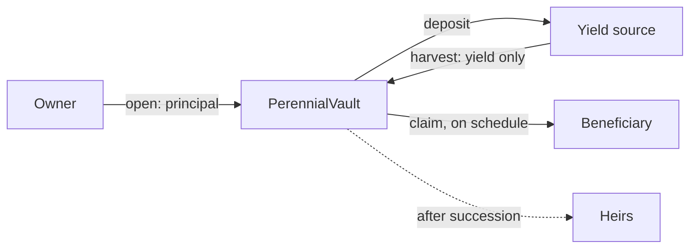

# Perennial

[](https://github.com/raldblox/perennial/actions/workflows/contracts.yml)
[](LICENSE)
[](https://build.qorechain.io/p/perennial)


**Spend the income. Never the capital.**

Perennial is an on-chain endowment with a living beneficiary. The capital is
never paid out; only what it earns is, on a schedule. A check-in proves the
beneficiary is still there, and when the check-ins stop, the income passes to
named heirs. Nobody holds the keys: the vault has no admin, and every
instruction that matters needs an ML-DSA-87 signature checked inside the
contract, so a classical key recovered by a quantum computer moves nothing.

It runs on the QoreChain testnet. The yield there is simulated.

## Why

An income meant to last decades has to outlive the keys that set it up. The
signatures that protect today's accounts will not last that long: a large
enough quantum computer recovers a secp256k1 private key from its public key,
and whoever holds that key can redirect a payout, fake a proof of life or take
the capital.

Products that fund something from yield exist, and most are a ledger run by
an operator who holds the money. Perennial keeps the capital, the schedule,
the heirs and every payout in a contract anyone can read, and trusts a
post-quantum signature instead of an operator or a classical key.

## Uses

At 5% a year with a 1.15 margin (the sizing below); at 4%, add a quarter.

| Use | Payout | Principal (fUSD) |
|---|---|---|
| An AI agent's running costs; its operators are the heirs | 250 a month | 69,000 |
| A parent's income, passing to the children | 400 a month | 110,400 |
| A personal income with heirs named up front | 1,000 a month | 276,000 |
| An open-source maintainer's stipend | 1,500 a month | 414,000 |
| A public good's fixed bill (endpoint, archive, domain) | 80 a month | 22,080 |

## How it works



- **Position.** A deposit is the position's *principal*. It sits in a yield
  source and is tracked as shares. Harvested yield lands in the position's
  *buffer*, and payouts are made from the buffer only.
- **Sizing.** To pay out `C` per year at a yield rate `r`, deposit
  `P = k · C / r`, where `k` is a safety margin (1.15 leaves 15% headroom:
  the yield can fall 13% before the payout outruns it). At 5%, a payout of
  400 a month needs 110,400.
- **Schedule.** Every `payoutInterval` the beneficiary can claim
  `payoutAmount`. A period the buffer cannot fund in full is paid in part and
  not carried over, so payouts never exceed what the principal has earned.
- **Proof of life.** The beneficiary checks in at least once per
  `checkInPeriod`. A claim counts. After `checkInPeriod + gracePeriod` of
  silence, anyone can trigger succession.
- **Succession.** Irreversible. The scheduled payouts are then split between
  the heirs by weight. The heirs inherit the income; the principal stays
  invested.
- **Permanence.** Unless the owner kept the right to close when opening, the
  principal can never be withdrawn by anyone.

### Who can do what

| Action | Authorised by | Notes |
|---|---|---|
| `open`, `topUp` | the caller's own tokens | the beneficiary must hold a proven ML-DSA-87 key |
| `harvest` | anyone | yield can only land in the position's buffer |
| `claim` | beneficiary's ML-DSA-87 signature | paid to the beneficiary whoever submits it |
| `checkIn` | beneficiary's ML-DSA-87 signature | |
| `setHeirs` | beneficiary's ML-DSA-87 signature | over the hash of the new list |
| `triggerSuccession` | anyone, after the deadline | |
| `distribute` | anyone, after succession | heirs and weights are frozen |
| `closeByOwner` | owner's ML-DSA-87 signature | only if the right was kept at opening |

A signed action is bound to the chain, the vault, the position, the action,
a nonce and a deadline. Because authority is the signature and not the
sender, anyone can submit it, including a relayer that pays the fee. The
reasoning is in [decision 001](docs/decisions/001-pq-signed-actions.md), and
what this protects against, and what it does not, is in the
[threat model](docs/threat-model.md).

The vault has no admin, no upgrade path and no pause.

## Status

| Part | State |
|---|---|
| Contracts | Implemented, 106 tests including invariant tests |
| Testnet deployment | Live on `qorechain-diana`, exercised end to end with real ML-DSA-87 signatures |
| Web app | Overview, sizing, opening a position, the position page and every vault action; 107 tests |

### Testnet addresses

QoreChain testnet (`qorechain-diana`, EVM chain id 9800).

| What | Address |
|---|---|
| PerennialVault | `0x2fB3057c42fB97964F5a86fD20ecD90969d06593` (`qor197es2lzzlwtevn66sm7jpmxep95aqevnrhsh9w`) |
| MockYieldSource (5% a year, simulated) | `0xBcC4ABe0B3aBfABa14eA1eFDBE5c87035f167f17` (`qor1hnz2hc9n40at5982rm7muhy8qd03vlchx773pc`) |
| Asset (fUSD) | `0x97143B771D34ddb9130b807b135Ae675A5a963CA` |
| Deployer | `0x825c2e0282c4681fad2f99F514d3D3003cd27432` (`qor1sfwzuq5zc35pltf0n863f57nqq7dyapj6gqlyg`) |
| Adversarial test account | `0x38FbFDdAE9E53fFb221c0b7E8dF993dC8C75917c` (`qor18ralmkhfu5llkgsupdlgm7vnmjx8tytunvzdqe`) |

The adversarial test account exists to be attacked: treat its secp256k1
private key as compromised. Its savings sit in position 2 of the vault. With
the classical key alone nobody can claim, check in, change its heirs or
close the position, and it keeps no EVM window open, so that key cannot move
its QOR either.

`pnpm e2e <vault>` in `contracts/` opens a position on the live vault, checks
in, claims and closes with real ML-DSA-87 signatures, and confirms that a
forged, a mismatched and a replayed signature are each refused. Positions 1
and 3 are closed runs of it.

### What is simulated

- **The yield.** The only yield source in the repository is
  `MockYieldSource`, which pays a fixed 5% a year out of a reserve someone
  funded in advance. Nothing earns it, and when the reserve runs short,
  harvests and claims fail until it is refilled; see
  [decision 002](docs/decisions/002-yield-source.md).
- **The tokens.** fUSD is the testnet's dollar token. It has no value.
- **The precompiles, in unit tests only.** Foundry's local EVM does not have
  QoreChain's PQC precompiles, so unit tests run against a mock of them. Real
  ML-DSA-87 verification happens only on the chain, in the end-to-end script
  and in the app.

**Where it runs.** The precompiles Perennial depends on are active on the
QoreChain testnet and not on mainnet. The deploy script refuses a chain
without them. The contracts have not been audited.

## The web app

`app/` is a static React app: an overview with the sizing calculator and live
figures read from the vault, a form to open a position (terms, heirs, review),
and a page per position with its deadlines, history and every action. Every
screen reads without an account.

**How it signs.** The QoreX wallet cannot yet sign arbitrary bytes or EVM
transactions for a web page, so the app derives the account's keys from a
recovery phrase typed into the page, keeps them in that tab's memory only, and
shows the exact bytes before every signature. Whoever controls the page's code
while it is unlocked can sign as that account: use a testnet-only phrase. The
options and the evidence are in
[decision 003](docs/decisions/003-browser-signing.md).

```sh
cd app
pnpm install
pnpm dev          # http://localhost:5173
pnpm test         # unit and component tests, chain mocked
pnpm build        # static output in app/dist
pnpm preview      # serve the build, with the native API forwarded
```

Configuration (chain, RPC, vault, asset) is in `app/src/config.ts`, with the
testnet deployment as the default and `VITE_` overrides listed in
`app/.env.example`. All wording is in `app/src/copy.ts`.

**Hosting.** The build is static and holds no secrets. Reading the vault and
sending transactions use the EVM JSON-RPC, which accepts any origin. Reading
and opening the account's EVM window use the chain's REST API and CometBFT
RPC, which refuse cross-origin requests, so the host must forward
`/qore/rest/*` to `https://api-testnet.qore.host/*` and `/qore/rpc` to
`https://rpc-testnet.qore.host/` (the dev and preview servers do), or
`VITE_REST_URL` and `VITE_RPC_URL` must point at a proxy that does. Without
that, the app still works, and asks the user to open the window in the QoreX
app or with `pnpm window open`.

`pnpm brand` in `app/` redraws the cover image, the link preview and the
icons from the design tokens.

## Quickstart (contracts)

Requires [Foundry](https://getfoundry.sh), Node.js 20 or later and pnpm.

```sh
git clone --recurse-submodules https://github.com/raldblox/perennial
cd perennial/contracts
pnpm install
forge test
```

### Deploy to the testnet

On QoreChain an account can send EVM transactions only after it has
registered an ML-DSA-87 key and opened an EVM authorisation window.

```sh
cp .env.example .env        # set QORE_MNEMONIC, or PRIVATE_KEY with a recovery code
pnpm window status          # shows the account, its key and its window
pnpm window register        # once per account
pnpm window open
pnpm deploy:dry-run         # simulation only
pnpm deploy:testnet
```

Use a testnet-only account. Never commit `.env`.

## Repository

```
contracts/
  src/PerennialVault.sol          the vault
  src/libraries/PQCAuth.sol       ML-DSA-87 key lookup and signature check
  src/interfaces/                 PQC precompiles, yield source
  src/mocks/MockYieldSource.sol   fixed-rate source for tests and testnet
  script/Deploy.s.sol             deployment
  scripts/window.ts               key registration and EVM window helper
  scripts/e2e.ts                  end-to-end run against the live vault
  test/                           unit, fuzz and invariant tests
app/
  src/config.ts                   chain, endpoints and addresses
  src/copy.ts                     every word the app shows
  src/chain/                      vault reads, writes, events, error decoding
  src/signer/session.ts           the unlocked account's keys, in memory
  src/lib/                        exact amounts, sizing, schedule, heirs
  src/pages/, src/components/     the screens
  scripts/brand.ts                cover image, link preview and icons
docs/
  qorechain-notes.md              what the protocol relies on from the chain
  threat-model.md                 assets, actors, trust, limitations
  decisions/                      design decisions
```

## Credits

- [QoreChain](https://qorechain.io): the ML-DSA-87 precompiles, the SDK
  (`@qorechain/sdk`, `@qorechain/evm`), `@qorechain/pqc`,
  `@qorechain/qorex-rainbowkit` and
  [`create-qorechain-dapp`](https://www.npmjs.com/package/create-qorechain-dapp),
  whose Foundry template the contracts tooling and `scripts/window.ts` start
  from, and whose `viem-wagmi` template the app starts from (Apache-2.0).
- [OpenZeppelin Contracts](https://github.com/OpenZeppelin/openzeppelin-contracts) (MIT).
- [Foundry](https://github.com/foundry-rs/foundry) and
  [forge-std](https://github.com/foundry-rs/forge-std) (MIT / Apache-2.0).
- [CosmJS](https://github.com/cosmos/cosmjs) (Apache-2.0).
- [viem](https://viem.sh), [wagmi](https://wagmi.sh) and
  [RainbowKit](https://rainbowkit.com) (MIT).
- [React](https://react.dev), [TanStack Query](https://tanstack.com/query),
  [Vite](https://vite.dev), [Vitest](https://vitest.dev),
  [Testing Library](https://testing-library.com),
  [ESLint](https://eslint.org) and
  [typescript-eslint](https://typescript-eslint.io) (MIT).
- [satori](https://github.com/vercel/satori) and
  [resvg-js](https://github.com/thx/resvg-js) (MPL-2.0), for the images.
- Fonts, bundled through [Fontsource](https://fontsource.org):
  [Source Serif 4](https://github.com/adobe-fonts/source-serif) and
  [IBM Plex](https://github.com/IBM/plex) (SIL Open Font License 1.1).

## License

[MIT](LICENSE)
