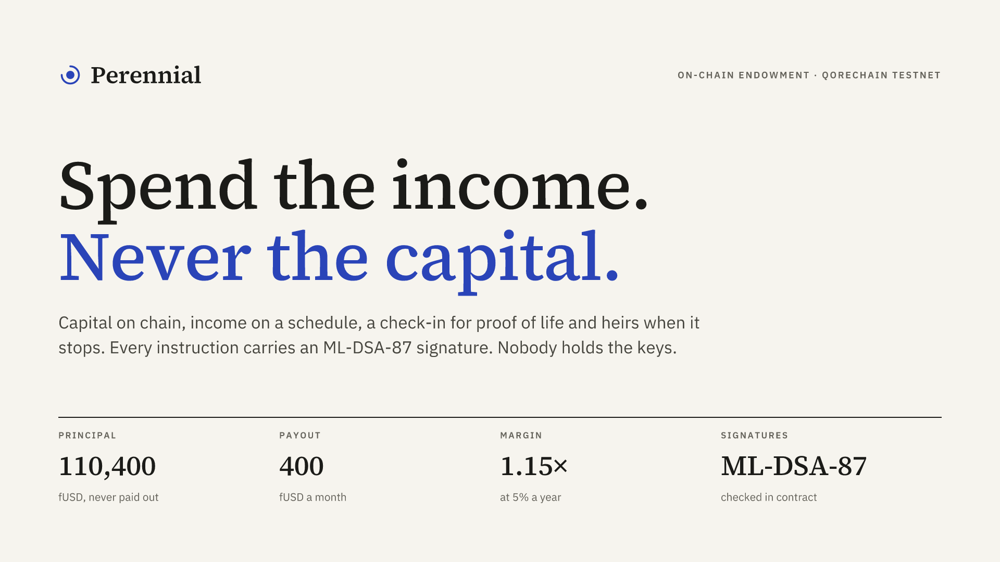
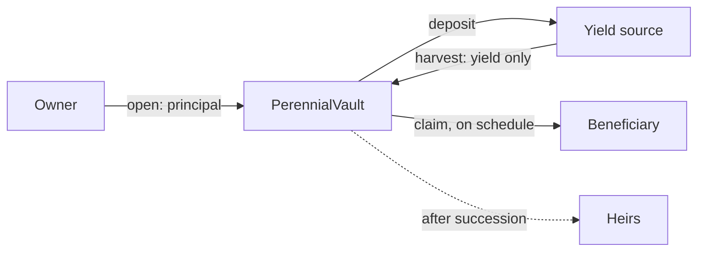

# Perennial

[](https://github.com/raldblox/perennial/actions/workflows/contracts.yml)
[](LICENSE)
[](https://build.qorechain.io/p/perennial)



A post-quantum pension protocol for humans and AI agents on QoreChain.

Deposit once. The principal stays invested and is never paid out; only what
it earns is. Payouts follow a schedule, a missed proof of life hands the
income to registered heirs, and every sensitive action needs an ML-DSA-87
signature, so a pension keeps working after Q-Day.

## Why

A pension is a promise that has to hold for decades. The signatures that
protect today's accounts will not: a large enough quantum computer recovers a
secp256k1 private key from its public key. Whoever holds that key can then
redirect a pension, fake a proof of life, or take the capital.

Perennial does not trust the classical key. Authority over a position is an
ML-DSA-87 signature, checked inside the contract through QoreChain's
post-quantum precompiles. A recovered classical key can do nothing to it.

## How it works



- **Position.** A deposit is the position's *principal*. It sits in a yield
  source and is tracked as shares. Harvested yield lands in the position's
  *buffer*, and payouts are made from the buffer only.
- **Sizing.** To pay out `C` per year at a yield rate `r`, deposit
  `P = k · C / r`, where `k` is a safety margin (1.15 leaves 15% headroom).
  At 5%, a payout of 400 a month needs about 110,400.
- **Schedule.** Every `payoutInterval` the beneficiary can claim
  `payoutAmount`. A period the buffer cannot fund in full is paid in part and
  not carried over, so payouts never exceed what the principal has earned.
- **Proof of life.** The beneficiary checks in at least once per
  `checkInPeriod`. A claim counts. After `checkInPeriod + gracePeriod` of
  silence, anyone can trigger succession.
- **Succession.** Irreversible. The scheduled payouts are then split between
  the heirs by weight. The heirs inherit the income; the principal stays
  invested.
- **Permanence.** Unless the owner kept the right to close when opening, the
  principal can never be withdrawn by anyone.

### Who can do what

| Action | Authorised by | Notes |
|---|---|---|
| `open`, `topUp` | the caller's own tokens | the beneficiary must hold a proven ML-DSA-87 key |
| `harvest` | anyone | yield can only land in the position's buffer |
| `claim` | beneficiary's ML-DSA-87 signature | paid to the beneficiary whoever submits it |
| `checkIn` | beneficiary's ML-DSA-87 signature | |
| `setHeirs` | beneficiary's ML-DSA-87 signature | over the hash of the new list |
| `triggerSuccession` | anyone, after the deadline | |
| `distribute` | anyone, after succession | heirs and weights are frozen |
| `closeByOwner` | owner's ML-DSA-87 signature | only if the right was kept at opening |

A signed action is bound to the chain, the vault, the position, the action,
a nonce and a deadline. Because authority is the signature and not the
sender, anyone can submit it, including a relayer that pays the fee. The
reasoning is in [decision 001](docs/decisions/001-pq-signed-actions.md).

The vault has no admin, no upgrade path and no pause.

## Status

Early development.

| Part | State |
|---|---|
| Contracts | Implemented, 106 tests including invariant tests |
| Testnet deployment | Live on `qorechain-diana`, exercised end to end with real ML-DSA-87 signatures |
| Web app | Not started |

### Testnet addresses

QoreChain testnet (`qorechain-diana`, EVM chain id 9800).

| What | Address |
|---|---|
| PerennialVault | `0x2fB3057c42fB97964F5a86fD20ecD90969d06593` (`qor197es2lzzlwtevn66sm7jpmxep95aqevnrhsh9w`) |
| MockYieldSource (5% a year, simulated) | `0xBcC4ABe0B3aBfABa14eA1eFDBE5c87035f167f17` (`qor1hnz2hc9n40at5982rm7muhy8qd03vlchx773pc`) |
| Asset (fUSD) | `0x97143B771D34ddb9130b807b135Ae675A5a963CA` |
| Deployer | `0x825c2e0282c4681fad2f99F514d3D3003cd27432` (`qor1sfwzuq5zc35pltf0n863f57nqq7dyapj6gqlyg`) |
| Pension holder whose classical key is public | `0x38FbFDdAE9E53fFb221c0b7E8dF993dC8C75917c` (`qor18ralmkhfu5llkgsupdlgm7vnmjx8tytunvzdqe`) |

The pension holder above is a deliberate test: its secp256k1 private key is
published, and its savings sit in position 2 of the vault. With the
classical key alone nobody can claim, check in, change its heirs or close
the position, and it keeps no EVM window open, so the key cannot move its
QOR either.

`pnpm e2e <vault>` in `contracts/` opens a position on the live vault, checks
in, claims and closes with real ML-DSA-87 signatures, and confirms that a
forged, a mismatched and a replayed signature are each refused.

**What is simulated.** The only yield source in the repository is
`MockYieldSource`, which pays a fixed rate out of a pre-funded reserve. No
real yield is earned yet; see
[decision 002](docs/decisions/002-yield-source.md). Unit tests run against a
mock of the PQC precompiles, because Foundry's local EVM does not have them;
real ML-DSA-87 verification happens only on the chain.

**Where it runs.** The precompiles Perennial depends on are active on the
QoreChain testnet (`qorechain-diana`, EVM chain id 9800) and not on mainnet.
The deploy script refuses a chain without them.

## Quickstart

Requires [Foundry](https://getfoundry.sh), Node.js 20 or later and pnpm.

```sh
git clone --recurse-submodules https://github.com/raldblox/perennial
cd perennial/contracts
pnpm install
forge test
```

### Deploy to the testnet

On QoreChain an account can send EVM transactions only after it has
registered an ML-DSA-87 key and opened an EVM authorisation window.

```sh
cp .env.example .env        # set QORE_MNEMONIC, or PRIVATE_KEY with a recovery code
pnpm window status          # shows the account, its key and its window
pnpm window register        # once per account
pnpm window open
pnpm deploy:dry-run         # simulation only
pnpm deploy:testnet
```

Use a testnet-only account. Never commit `.env`.

## Repository

```
contracts/
  src/PerennialVault.sol          the vault
  src/libraries/PQCAuth.sol       ML-DSA-87 key lookup and signature check
  src/interfaces/                 PQC precompiles, yield source
  src/mocks/MockYieldSource.sol   fixed-rate source for tests and testnet
  script/Deploy.s.sol             deployment
  scripts/window.ts               key registration and EVM window helper
  test/                           unit, fuzz and invariant tests
docs/
  qorechain-notes.md              what the protocol relies on from the chain
  decisions/                      design decisions
```

## Credits

- [QoreChain](https://qorechain.io): the ML-DSA-87 precompiles, the SDK
  (`@qorechain/sdk`, `@qorechain/evm`) and
  [`create-qorechain-dapp`](https://www.npmjs.com/package/create-qorechain-dapp),
  whose Foundry template (Apache-2.0) the contracts tooling and
  `scripts/window.ts` start from.
- [OpenZeppelin Contracts](https://github.com/OpenZeppelin/openzeppelin-contracts) (MIT).
- [Foundry](https://github.com/foundry-rs/foundry) and
  [forge-std](https://github.com/foundry-rs/forge-std) (MIT / Apache-2.0).
- [CosmJS](https://github.com/cosmos/cosmjs) (Apache-2.0).

## License

[MIT](LICENSE)
