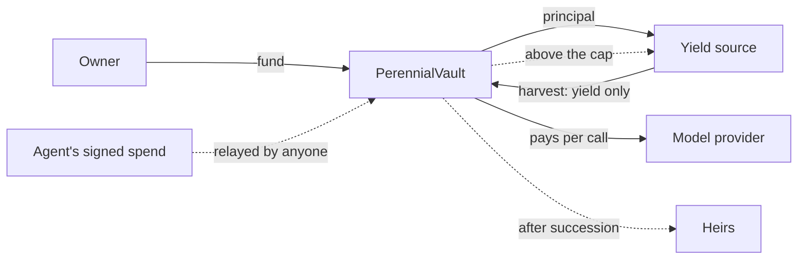

# Perennial

[](https://github.com/raldblox/perennial/actions/workflows/contracts.yml)
[](LICENSE)
[](https://build.qorechain.io/p/perennial)


**An inference budget your agent spends and nobody can steal.**

## What it does

You fund a position for an AI agent. The agent pays for each model call from
it with `spend()`, signed by its own ML-DSA-87 key and verified inside the
contract. In budget mode no more than `payoutAmount` leaves the position per
`payoutInterval`, across spends and claims; a fuzz test and an invariant check
that bound ([decision 007](docs/decisions/007-budget-mode-and-income.md)).
Behind every agent is a person: the owner who funds it and can stop it.

For one 0.002 fUSD call an hour, a 500 fUSD position with a 1.46 fUSD monthly
budget lasts 28.5 years at 0% yield, which is what QoreChain pays a contract
today. Connected to a yield vault, the budget refills itself and **lasts
indefinitely when the yield covers the spend**: at Aave v3 USDC's 4.29% (its
30-day mean on Ethereum, 16 November 2026) the same 500 fUSD earns 21.45 fUSD
a year against 17.52 spent. On the testnet every yield is simulated.

Reference rates, 30-day means on Ethereum from DefiLlama's yields API on
16 November 2026 (`pnpm rates` in `app/` prints the current ones):
Sky savings (sUSDS) 3.80%, Aave v3 USDC supply 4.29%, Ethena sUSDe 5.06%.
These reference rates are paid on other chains, vary, and carry their protocols' risks; they are the planning assumption for a later deployment on a chain where such vaults exist, which is what the ERC-4626 and Aave adapters are for.

## Why nobody can steal it

A funded wallet gives everything to whoever holds its key. A position does
not, because every instruction needs a post-quantum signature checked in the
contract ([decision 001](docs/decisions/001-pq-signed-actions.md),
[threat model](docs/threat-model.md)):

| Who has what | What they can take |
|---|---|
| A recovered or stolen **classical (secp256k1) key** of the agent or the owner, for example by a quantum computer | nothing: no spend, claim, check-in, heir change or close |
| The agent's stolen **ML-DSA-87 key** | at most one budget window (budget mode) or the buffer, until the owner closes |
| The owner's ML-DSA-87 key | the right to close, if it was kept at opening |

- **The owner** funds the position with a key kept offline and can close it.
- **The agent** has its own account and ML-DSA-87 key and can spend only
  within the limit.
- **Heirs** receive the budget if the agent stops checking in (succession).

There is no admin, no custodian and no upgrade path.

## How it connects

Three projects, one loop. Each works alone.

| Project | Role | Link |
|---|---|---|
| **Perennial** (this repo) | holds the budget and enforces the limit | [app](https://perennial-flax.vercel.app) |
| **PQ-402** | how one call is paid from it: an HTTP 402 answered with an ML-DSA-87 signed payment; its `perennial` scheme is a Perennial `spend`, relayed by a facilitator, with `ref` binding the HTTP request | [github.com/raldblox/pq-402](https://github.com/raldblox/pq-402), [`@pq402/*` on npm](https://www.npmjs.com/search?q=%40pq402) |
| **Overwinter** | the inference service: an OpenAI-compatible endpoint that charges per call through PQ-402 | [github.com/raldblox/overwinter](https://github.com/raldblox/overwinter) |

## How it works



1. **Fund.** The deposit is the position's *principal*. It goes into the
   yield source. In budget mode it is spent at the capped rate; otherwise it
   is never paid out. Anyone can add income with `fund`.
2. **Earn.** A harvest, which anyone can call, moves what the principal has
   earned into the position's *buffer*.
3. **Spend.** For each call, the agent signs
   `spend(positionId, to, amount, ref, deadline, signature)` with its
   ML-DSA-87 key: who is paid, how much, and a reference to the request.
   Anyone can submit it, so the agent needs neither QOR nor an EVM window; the
   vault pays from the buffer (in budget mode, then from the principal, within
   the limit) and emits `Spent(positionId, to, amount, ref)`.
4. **Compound.** Yield above the position's buffer cap is added to the
   principal, so it keeps earning and can never be spent. A spend, claim or
   check-in is proof of life; after the check-in period and a grace period of
   silence, anyone can trigger succession and the income goes to the heirs.

**Sizing.** For `C` a year of calls at yield rate `r`, deposit
`P = k · C / r` with a margin `k` (1.15 lets the yield fall 13% before calls
go unpaid). One 0.002 call an hour is 17.52 a year, so `P` is about 470 at
Aave v3 USDC's 4.29%, about 530 at sUSDS's 3.80% and about 398 at sUSDe's 5.06%.

### Who can do what

| Action | Authorised by | Notes |
|---|---|---|
| `open`, `topUp` | the caller's own tokens | the beneficiary must hold a proven ML-DSA-87 key |
| `harvest` | anyone | yield lands in the buffer, above the cap in the principal |
| `spend` | beneficiary's ML-DSA-87 signature | over `(to, amount, ref)`; from the buffer only; counts as a check-in |
| `claim` | beneficiary's ML-DSA-87 signature | the schedule's amount, to the beneficiary itself |
| `checkIn` | beneficiary's ML-DSA-87 signature | |
| `setHeirs` | beneficiary's ML-DSA-87 signature | over the hash of the new list |
| `triggerSuccession` | anyone, after the deadline | cannot be undone |
| `distribute` | anyone, after succession | heirs and weights are frozen |
| `closeByOwner` | owner's ML-DSA-87 signature | only if the right was kept at opening |

A signed action is bound to the chain, the vault, the position, the action,
a nonce and a deadline ([decision 001](docs/decisions/001-pq-signed-actions.md)).
`spend` is [decision 005](docs/decisions/005-spend.md), the buffer cap is
[decision 004](docs/decisions/004-buffer-cap.md), and what all this protects
against is in the [threat model](docs/threat-model.md).

## Other uses

The same vault pays people on a schedule: a public good's fixed bill (10 a
month needs 3,217), a maintainer's stipend (100 a month, 32,168), a parent's
allowance passing to the children (250 a month, 80,420). Each at Aave v3
USDC's 4.29% with a 1.15 margin.

## Status

| Part | State |
|---|---|
| Contracts | One `PerennialVault` with `spend`, the buffer cap, opt-in budget mode and `fund`; 179 tests including fuzz and invariant tests, and optional fork tests against real sources; adapters for ERC-4626 vaults and Aave V3 markets |
| Testnet | Deployed on `qorechain-diana` as three vaults: no yield, one simulated at the Aave v3 USDC rate of 16 November 2026, and an accelerated demo rate; earlier test deployments are retired |
| Web app | Fund an agent, budget mode, income paid in, a control panel per position with how long it lasts, an in-page QOR to fUSD swap |
| Review | Not audited. The first AI review is answered finding by finding in [docs/AUDIT.md](docs/AUDIT.md) |

### Money in, money out

- **Principal**: `open` deposits it, and `topUp` adds to it. Anyone may top up
  any open position, any number of times; a test makes twelve top-ups from
  twelve different payers and checks the principal is their sum. One asset
  per vault.
- **Income**: `fund(positionId, amount)` pays straight into the buffer.
  Anyone may, for example a customer paying an agent; the event `Funded`
  names the payer. Above the buffer cap it joins the principal, like yield.
- **Budget mode**, chosen at opening and fixed: spends and claims may draw on
  the principal once the buffer is empty, never more than `payoutAmount` per
  `payoutInterval` in total, and never more than the position holds
  ([decision 007](docs/decisions/007-budget-mode-and-income.md)). Off, the
  principal is never spent.

### Testnet addresses

QoreChain testnet (`qorechain-diana`, EVM chain id 9800). Transactions,
constructor arguments, compiler settings and the retired test deployments
are in [docs/deployments.md](docs/deployments.md).

| What | Address |
|---|---|
| PerennialVault, no yield (its source pays nothing) | `0x76DAC5461fF361f911e5F39810c9455a6180C180` |
| PerennialVault, simulated at the Aave v3 USDC rate of 16 November 2026 (4.29%, never a return it earns) | `0x78075C631D41AF72c69e34120d5C33cDC7A66A71` |
| PerennialVault, accelerated testnet rate (simulated, not a return) | `0x496AAa4D585B97c8a26095D97Af4bBfAd473798c` |
| Asset (fUSD) | `0x97143B771D34ddb9130b807b135Ae675A5a963CA` |
| Deployer | `0x825c2e0282c4681fad2f99F514d3D3003cd27432` (`qor1sfwzuq5zc35pltf0n863f57nqq7dyapj6gqlyg`) |
| Adversarial test account | `0x38FbFDdAE9E53fFb221c0b7E8dF993dC8C75917c` (`qor18ralmkhfu5llkgsupdlgm7vnmjx8tytunvzdqe`) |

The adversarial test account exists to be attacked: treat its secp256k1
private key as compromised. Its savings sit in position 2 of a retired test
vault, `0x2fB3057c42fB97964F5a86fD20ecD90969d06593`. With the classical key
alone nobody can claim, check in, change its heirs or close the position,
and it keeps no EVM window open, so that key cannot move its QOR either.

`pnpm e2e <vault>` in `contracts/` opens a position on a live vault, checks
in, claims, spends from the buffer and closes with real ML-DSA-87 signatures,
and confirms that a forged, a mismatched and a replayed signature, and a
spend to a different recipient, are each refused.

### What is simulated

- **The yield.** Each vault's principal sits in `MockYieldSource`, which pays
  a fixed rate out of a reserve someone funded. Nothing earns it. Nothing on
  QoreChain pays a real return a Solidity contract can collect today: AMM
  fees, staking and staking tiers are native-lane only
  ([decision 006](docs/decisions/006-yield-sources.md)). The no-yield vault
  shows the vault as it would run on QoreChain today. On other EVM chains a
  new vault can use a real ERC-4626 vault directly or through
  `ERC4626Source`, or an Aave V3 market through `AaveV3Source`
  ([decision 008](docs/decisions/008-yield-sources-on-other-chains.md));
  none of these is deployed on this testnet.
- **The demo rate.** The demo vault's source pays 15,768% a year so that
  20 fUSD visibly pays about 2.6 calls a minute in a demonstration. It is a
  test setting, never a return, and is labelled wherever it appears.
- **The tokens.** fUSD is the testnet's dollar token. It has no value.
- **The precompiles, in unit tests only.** Foundry's local EVM does not have
  QoreChain's PQC precompiles, so unit tests run against a mock of them. Real
  ML-DSA-87 verification happens on the chain, in the end-to-end script and
  in the app.

**Where it runs.** The precompiles Perennial depends on are active on the
QoreChain testnet and not on mainnet. The contracts have not been audited.

## The web app

`app/` is a static React app. **Fund an agent** sizes a deposit from calls an
hour and a price per call, sets the buffer cap (a day of calls by default),
and opens the position. Each position has a **control panel**: health
(buffer runway at the last day's spending, earning against spending, the
check-in deadline), a ledger of every harvest, spend, claim, top-up and
compounding with its transaction and reference, and controls to send a
signed payment, add principal, claim, change heirs and close. Every screen
reads without an account. An account panel can swap up to 1 QOR for fUSD in
the native AMM.

**How it signs.** The QoreX wallet cannot yet sign arbitrary bytes or EVM
transactions for a web page, so the app derives the account's keys from a
recovery phrase typed into the page, keeps them in that tab's memory only, and
shows the exact bytes before every signature. Whoever controls the page's code
while it is unlocked can sign as that account: use a testnet-only phrase
([decision 003](docs/decisions/003-browser-signing.md)).

```sh
cd app
pnpm install
pnpm dev          # http://localhost:5173
pnpm test         # unit and component tests, chain mocked
pnpm build        # static output in app/dist
pnpm preview      # serve the build, with the native API forwarded
```

Configuration (chain, RPC, vaults, asset, AMM pool) is in
`app/src/config.ts`, with the testnet deployment as the default and `VITE_`
overrides listed in `app/.env.example`. All wording is in `app/src/copy.ts`.

**Hosting.** The build is static and holds no secrets. Reading the vaults and
sending transactions use the EVM JSON-RPC, which accepts any origin. Reading
and opening the account's EVM window, and the swap, use the chain's REST API
and CometBFT RPC, which refuse cross-origin requests, so the host must forward
`/qore/rest/*` to `https://api-testnet.qore.host/*` and `/qore/rpc` to
`https://rpc-testnet.qore.host/` (the dev and preview servers do), or
`VITE_REST_URL` and `VITE_RPC_URL` must point at a proxy that does. Without
that, the app still works, and says how to open the window in the QoreX app or
with `pnpm window open`, and to swap with `pnpm swap`.

`pnpm brand` in `app/` redraws the cover image, the link preview and the
icons from the design tokens.

## Quickstart (contracts)

Requires [Foundry](https://getfoundry.sh), Node.js 20 or later and pnpm.

```sh
git clone --recurse-submodules https://github.com/raldblox/perennial
cd perennial/contracts
pnpm install
forge test
```

### Deploy to the testnet

On QoreChain an account can send EVM transactions only after it has
registered an ML-DSA-87 key and opened an EVM authorisation window. A window
scoped to contracts refuses contract creation, so deploy under a small
unscoped window and close it right after.

```sh
cp .env.example .env        # set QORE_MNEMONIC, or PRIVATE_KEY with a recovery code
pnpm window status          # shows the account, its key and its window
pnpm window register        # once per account
pnpm window open
pnpm deploy:dry-run         # simulation only
pnpm deploy:testnet
pnpm window close
pnpm swap 1                 # optional: 1 QOR for fUSD in the native AMM, converted for contracts
```

Use a testnet-only account. Never commit `.env`.

## Repository

```
contracts/
  src/PerennialVault.sol          the vault
  src/libraries/PQCAuth.sol       ML-DSA-87 key lookup and signature check
  src/adapters/ERC4626Source.sol  guarded adapter for real ERC-4626 vaults
  src/interfaces/                 PQC precompiles, yield source
  src/mocks/MockYieldSource.sol   fixed-rate source for tests and testnet
  script/Deploy.s.sol             deployment
  scripts/window.ts               key registration and EVM window helper
  scripts/e2e.ts                  end-to-end run against a live vault
  scripts/swap.ts                 QOR to fUSD in the native AMM
  test/                           unit, fuzz and invariant tests
app/
  src/config.ts                   chain, endpoints, vaults and addresses
  src/copy.ts                     every word the app shows
  src/chain/                      vault reads, writes, events, error decoding
  src/signer/session.ts           the unlocked account's keys, in memory
  src/lib/                        exact amounts, sizing, schedule, heirs, swaps
  src/pages/, src/components/     the screens
  scripts/brand.ts                cover image, link preview and icons
docs/
  qorechain-notes.md              what the protocol relies on from the chain
  deployments.md                  addresses, transactions, compiler settings
  threat-model.md                 assets, actors, trust, limitations
  AUDIT.md                        AI contract review record
  decisions/                      design decisions
```

## Credits

- [QoreChain](https://qorechain.io): the ML-DSA-87 precompiles, the native
  AMM, the SDK (`@qorechain/sdk`, `@qorechain/evm`), `@qorechain/pqc`,
  `@qorechain/qorex-rainbowkit` and
  [`create-qorechain-dapp`](https://www.npmjs.com/package/create-qorechain-dapp),
  whose Foundry template the contracts tooling and `scripts/window.ts` start
  from, and whose `viem-wagmi` template the app starts from (Apache-2.0).
- [OpenZeppelin Contracts](https://github.com/OpenZeppelin/openzeppelin-contracts) (MIT),
  including the ERC-4626 implementation the adapter is tested against.
- [Foundry](https://github.com/foundry-rs/foundry) and
  [forge-std](https://github.com/foundry-rs/forge-std) (MIT / Apache-2.0).
- [CosmJS](https://github.com/cosmos/cosmjs) (Apache-2.0).
- [viem](https://viem.sh), [wagmi](https://wagmi.sh) and
  [RainbowKit](https://rainbowkit.com) (MIT).
- [React](https://react.dev), [TanStack Query](https://tanstack.com/query),
  [Vite](https://vite.dev), [Vitest](https://vitest.dev),
  [Testing Library](https://testing-library.com),
  [ESLint](https://eslint.org) and
  [typescript-eslint](https://typescript-eslint.io) (MIT).
- [satori](https://github.com/vercel/satori) and
  [resvg-js](https://github.com/thx/resvg-js) (MPL-2.0), for the images.
- Fonts, bundled through [Fontsource](https://fontsource.org):
  [Source Serif 4](https://github.com/adobe-fonts/source-serif) and
  [IBM Plex](https://github.com/IBM/plex) (SIL Open Font License 1.1).

## License

[MIT](LICENSE)
